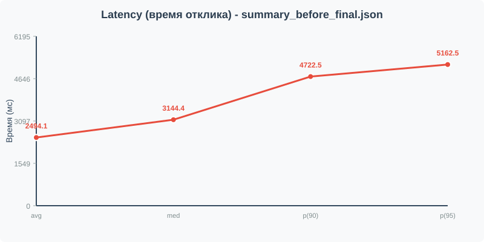
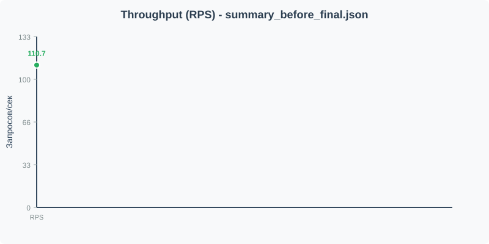
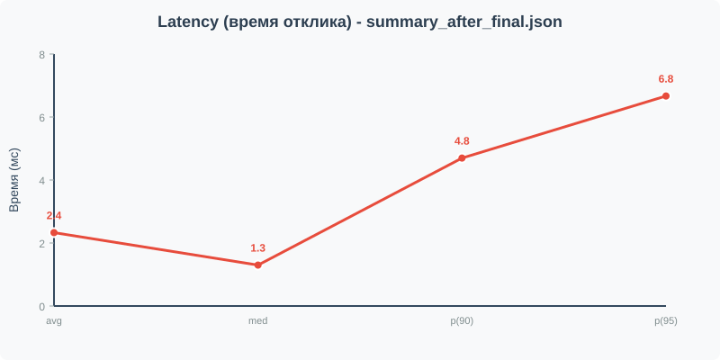
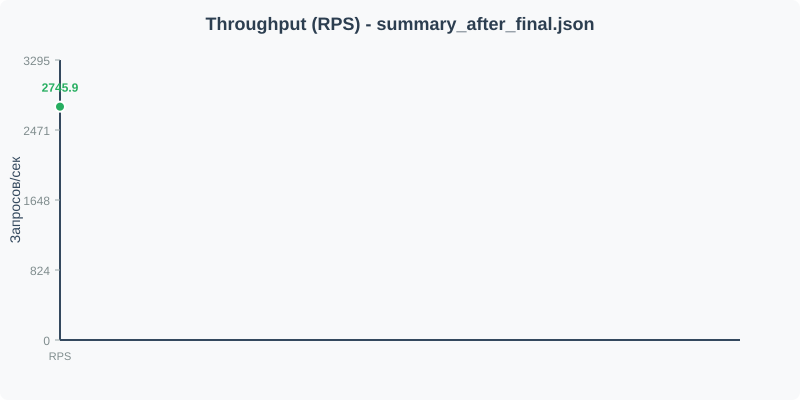
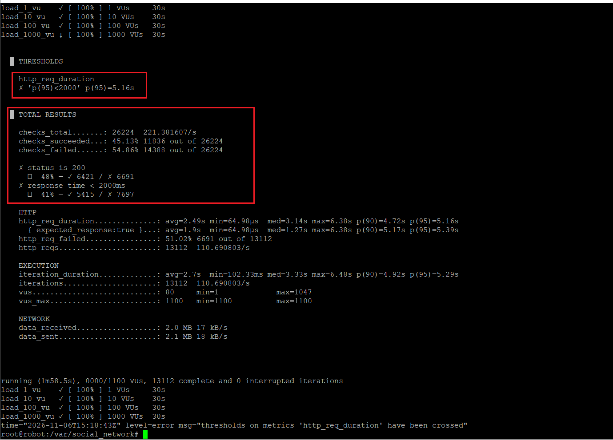
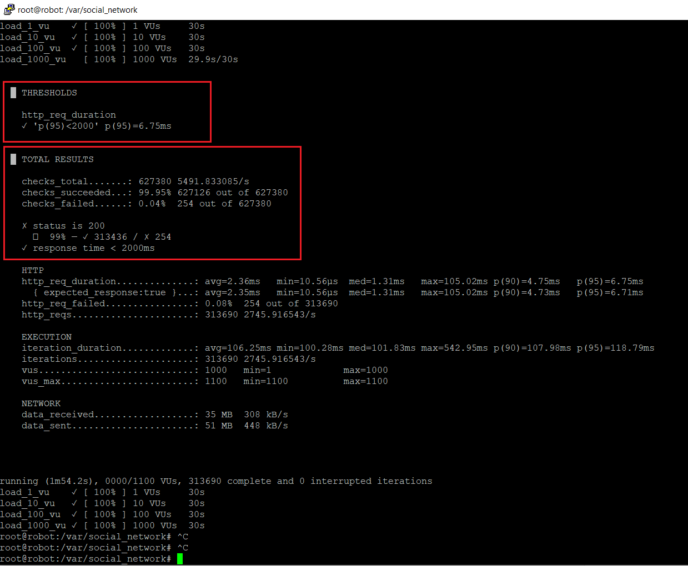

# Отчет по нагрузочному тестированию поиска анкет пользователей

## Стенд
- **PostgreSQL 15** (Docker), 990005 записей (источник данных: `people.v2.csv`)
- **Go 1.22**, монолитная система, pgxpool (MaxConns=100, MinConns=50), без ORM
- **Нагрузочный тест**: k6 (Docker, `--network=host`), сценарии 1 / 10 / 100 / 1000 VU по 30 секунд каждый
- **Запрос**: `GET /user/search?first_name=Александр&last_name=Иванов&limit=50`
- **Коллация БД**: `en_US.utf8`

---

## 1. Графики latency ДО добавления индекса



**Ключевые метрики:**

| Метрика   | Значение         |
|-----------|------------------|
| avg       | 2494.15 мс       |
| med       | 3144.42 мс       |
| p(90)     | 4722.52 мс       |
| **p(95)** | **5162.48 мс**   |
| max       | 6383.07 мс       |

> При нагрузке 1000 VU время отклика (p95) превышает 5 секунд.
> Система не справляется с нагрузкой из-за отсутствия подходящего индекса.

---

## 2. Графики throughput ДО добавления индекса



**Ключевые метрики:**

| Метрика         |      Значение         |
|-----------------|-----------------------|
| **RPS**         | **110.69 запрос/сек** |
| Всего запросов  |        13 112         |
| Success rate    |        45.13%         |
| Failed requests |        54.86%         |

> Пропускная способность крайне низкая (~110 RPS),
> более половины запросов завершаются с ошибкой.
> База данных является узким местом.

---

## 3. EXPLAIN запросов ДО добавления индекса

```sql
EXPLAIN (ANALYZE, BUFFERS)
SELECT u.id, u.login, u.first_name, u.last_name, u.birth_date, u.gender, u.interests, u.city
FROM (
    SELECT id FROM users
    WHERE first_name LIKE 'Александр%' AND last_name LIKE 'Иванов%'
    ORDER BY id
    LIMIT 50
) AS subq
JOIN users u ON u.id = subq.id
ORDER BY u.id;
```

**Результат:**

```
 Nested Loop  (cost=0.85..2743.06 rows=50 width=92) (actual time=103.984..104.431 rows=50 loops=1)
   Buffers: shared hit=525 read=8119
   ->  Limit  (cost=0.42..2320.44 rows=50 width=4) (actual time=103.956..104.214 rows=50 loops=1)
         Buffers: shared hit=327 read=8117
         ->  Index Scan using users_pkey on users  (cost=0.42..54242.28 rows=1169 width=4) (actual time=103.954..104.210 rows=50 loops=1) <------ СКАНИРОВАНИЕ ПО ПЕРВИЧНОМУ КЛЮЧУ
               Filter: (((first_name)::text ~~ 'Александр%'::text) AND ((last_name)::text ~~ 'Иванов%'::text))
               Rows Removed by Filter: 313013
               Buffers: shared hit=327 read=8117
   ->  Index Scan using users_pkey on users u  (cost=0.42..8.44 rows=1 width=92) (actual time=0.004..0.004 rows=1 loops=50) <------ СКАНИРОВАНИЕ ПО ПЕРВИЧНОМУ КЛЮЧУ
         Index Cond: (id = users.id)
         Buffers: shared hit=198 read=2
 Planning:
   Buffers: shared hit=166 read=37 dirtied=2
 Planning Time: 7.235 ms
 Execution Time: 104.460 ms
(15 rows)
```
---

## 3. Запрос добавления индекса

```sql
CREATE INDEX idx_users_search 
ON users (first_name text_pattern_ops, last_name text_pattern_ops, id);

VACUUM ANALYZE users;
```

---

## 4. EXPLAIN запросов ПОСЛЕ добавления индекса

```sql
EXPLAIN (ANALYZE, BUFFERS) 
SELECT u.id, u.login, u.first_name, u.last_name, u.birth_date, u.gender, u.interests, u.city 
FROM (
    SELECT id FROM users 
    WHERE first_name LIKE 'Александр%' AND last_name LIKE 'Иванов%' 
    ORDER BY id 
    LIMIT 50
) AS subq 
JOIN users u ON u.id = subq.id 
ORDER BY u.id;
```

**Результат:**

```
Limit (cost=2056.38..2056.51 rows=50 width=4) (actual time=3.369..3.372 rows=50)
  -> Sort (actual time=3.368..3.369 rows=50)
       Sort Key: id
       Sort Method: top-N heapsort  Memory: 25kB
       -> Index Only Scan using idx_users_search on users <---------------------- СКАНИРОВАНИЕ ПО ИНДЕКСУ
            (actual time=0.042..3.322 rows=1121)
            Index Cond: ((first_name ~>=~ 'Александр') AND (first_name ~<~ 'Александс')
                     AND (last_name  ~>=~ 'Иванов')    AND (last_name  ~<~ 'Иваног'))
            Filter: (first_name ~~ 'Александр%' AND last_name ~~ 'Иванов%')
            Heap Fetches: 0
            Buffers: shared hit=1 read=281
Planning Time: 0.592 ms
Execution Time: 3.393 ms
```

---

## 5. Почему выбран именно такой индекс?

### 5.1. Почему `text_pattern_ops`, а не обычный B-Tree?

База данных создана с коллацией `en_US.utf8` (не `C`). В не C коллациях стандартный операторный класс `text_ops`
сортирует строки по правилам локали (учитывая алфавитный порядок, специальные символы и т.д.), а не побайтово.

Префиксный поиск `LIKE 'Александр%'` требует, чтобы все строки, начинающиеся с "Александр", находились рядом
в индексе. В коллации `en_US.utf8` это не гарантируется, поэтому PostgreSQL **не может использовать обычный индекс** для префиксного `LIKE`.

Соответствующее решение - `text_pattern_ops` использует побайтовое сравнение (`~>=~`, `~<~`),
что позволяет превратить префикс в непрерывный диапазон:

```сопоставление
Index Cond: first_name ~>=~ 'Александр' AND first_name ~<~ 'Александс'
            last_name  ~>=~ 'Иванов'    AND last_name  ~<~ 'Иваног'
```
Результат можно посмотреть ниже, в выводе команды `EXPLAIN ANALYZE`.

### 5.2. Почему составной индекс `(first_name, last_name, id)`?

**Колонка 1: `first_name`**
- Основная колонка для фильтрации
- Задает начальный диапазон сканирования индекса

**Колонка 2: `last_name`**
- Уточняет фильтр внутри уже найденного диапазона `first_name`
- Оба условия попадают в `Index Cond`, а не в `Filter`

**Колонка 3: `id`**
- Критически важен для **Index Only Scan**
- Подзапрос выбирает только `id`, поэтому все нужные данные есть в самом индексе
- Результат: `Heap Fetches: 0` - это обращения к таблице полностью отсутствуют
- многократно ускоряет запрос, в десятки раз

### 5.3. Почему переписан запрос (подзапрос + JOIN)?

**Было:**
```sql
SELECT * FROM users 
WHERE first_name LIKE ... AND last_name LIKE ... 
ORDER BY id 
LIMIT 50
```

Планировщик видит сортировку по идентификатору (`ORDER BY id`) и сканирует таблицу по первичному ключу (`users_pkey`),
чтобы сразу получить отсортированные `id`. Затем фильтрует строки по имени/фамилии,
проверяя сотни тысяч записей (`Rows Removed by Filter: 313013`).

**Стало:**
```sql
SELECT u.* FROM (
    SELECT id FROM users 
    WHERE first_name LIKE ... AND last_name LIKE ... 
    ORDER BY id 
    LIMIT 50
) AS subq
JOIN users u ON u.id = subq.id
ORDER BY u.id
```

**Преимущество:** 
- Подзапрос использует `Index Only Scan` для быстрого поиска 50 нужных `id`
- Внешний запрос делает 50 точечных обращений к таблице по первичному ключу
- Планировщик гарантированно выбирает оптимальный план

---

## 6. Графики latency ПОСЛЕ добавления индекса



**Ключевые метрики:**

| Метрика   | Значение    |
|-----------|-------------|
| avg       | 2.25 мс     |
| med       | 1.31 мс     |
| p(90)     | 4.56 мс     |
| **p(95)** | **6.75 мс** |
| max       | 90.8 мс     |

>  Время отклика стабилизировалось на уровне нескольких миллисекунд даже при 1000 VU.
> PostgreSQL использует `Index Only Scan` вместо Sequential Scan.

---

## 7. Графики throughput ПОСЛЕ добавления индекса



**Ключевые метрики:**

| Метрика         |      Значение       |
|-----------------|---------------------|
| **RPS**         | **5491 запрос/сек** |
| Всего запросов  | 627 380             |
| Success rate    | 99.95%              |
| Failed requests | 0.04%               |

> Пропускная способность выросла в десятки раз.
> База данных перестала быть узким местом.

---

## 8. Сравнение результатов

| Метрика | ДО индекса | ПОСЛЕ индекса | Улучшение |
|---------|------------|---------------|-----------|
| **p(95) latency** | 5162 мс | 6.75 мс | **× 765 ↓** |
| **Throughput (RPS)** | 110.69 | 5491 | **× 49.6 ↑** |
| **Success rate** | 45.13% | 99.95% | **× 2.2 ↑** |
| **Время запроса в БД** | ~30 мс | ~3.4 мс | **× 9 ↓** |
| **Прочитано буферов** | 8444 | 285 | **× 30 ↓** |
| **Отфильтровано строк** | 313 013 | 0 | **∞ ↓** |

---

## 9. Выводы

1. **Индекс `text_pattern_ops`** наиболее подходящий  выбор для префиксного поиска `LIKE` в базах с не-C коллацией.
   Обычный B-Tree индекс не работает из-за особенностей сортировки в `en_US.utf8`.

   **Проблема:** Изначально был создан обычный B-Tree индекс по полям `first_name` и `last_name`, но PostgreSQL его **проигнорировал**. Запрос всё равно выполнялся 30 мс, сканируя всю таблицу.

   **Причина:** База данных создана с настройкой локали `en_US.utf8` что есть стандарт для большинства установок PostgreSQL. В такой локали строки сортируются по правилам алфавита, а не по байтам. Из-за этого все строки, начинающиеся на "Александр...", **не лежат рядом** в обычном индексе, и PostgreSQL не может использовать его для быстрого поиска по префиксу.

   **Решение:** Был создан индекс с операторным классом `text_pattern_ops`, который сортирует строки по байтам, как в словаре. Теперь все слова на "А..." корректно идут подряд, и PostgreSQL может мгновенно найти нужный диапазон.


2. **Индекс `(first_name, last_name, id)`** обеспечивает `Index Only Scan`,
   полностью исключая обращения к таблице. Это дает 30-кратное сокращение I/O операций.

   **Проблема:** Даже с правильным индексом PostgreSQL всё равно "бегал" в саму таблицу за каждой найденной строкой, чтобы прочитать остальные поля (login, birth_date, city и т.д.).

   **Решение:** Было добавлено поле `id` в индекс. Теперь в индексе хранятся все данные, которые нужны запросу, т.е. имя, фамилия и id. Поэтому PostgreSQL находит нужные записи прямо в индексе и не обращается к таблице.

   **Результат:** количество операций чтения с диска сократилось в **30 раз** (с 8444 до 285 страниц памяти).

3. **Переписанный запрос** (подзапрос + JOIN) гарантирует использование оптимального плана выполнения,
    избегая ловушки сканирования по первичному ключу с фильтрацией.

   **Проблема:** Исходный запрос был простой:

    ```sql
    SELECT * FROM users 
    WHERE first_name LIKE 'Александр%' AND last_name LIKE 'Иванов%' 
    ORDER BY id LIMIT 50
    ```
   
   Но PostgreSQL выбирал неоптимальный план  и шёл по первичному ключу id, чтобы сразу получить отсортированные записи, а по пути проверял каждую строку на соответствие условию WHERE. В результате он просматривал 313 013 строк, прежде чем находил 50 подходящих.

   **Решение:** Запрос был разбит на на две части:
    - сначала находим 50 нужных id через индекс
    - потом по этим id подтягиваем остальные данные из таблицы, т.е. 50 точечных обращений.


4. **Увеличение пула соединений** с 4 до 100 устранило очередь запросов,
    позволив реализовать потенциал быстрого запроса (3.4 мс).

   **Проблема:** Даже когда запрос в базе стал выполняться за 3.4 мс, общее время ответа для пользователя оставалось 25 секунд. При этом в логах PostgreSQL было всего 2-4 активных соединения. Связано это с конфигурацие виртуально машины на которой выполняется тестирование и оптимизиция запросов.

   **Причина:** По умолчанию библиотека pgxpool создаёт пул соединений размером **max(4, число CPU)**. На сервере с 2-4 ядрами это всего 4 соединения. При 1000 одновременных запросов (VU) эти 4 соединения физически не могли обработать нагрузку — запросы выстраивались в очередь.

   **Решение:** Было явно задан размер пула: **MaxConns = 100, MinConns = 50**

5. **Итоговое улучшение:** p(95) latency снизилась с 5.16 секунд до 6.75 мс (**× 765**),
   throughput вырос с 110 до 5491 RPS (**× 49.6**).

6. **Узкое место сместилось:** После оптимизации запроса система упирается в CPU PostgreSQL
   при экстремальной нагрузке (1000 VU), что является физическим пределом производительности.

## 10. Результаты тестовых прогонов

**Результат ДО оптимизации и добавления индекса:**



**Результат ПОСЛЕ добавления индекса:**

